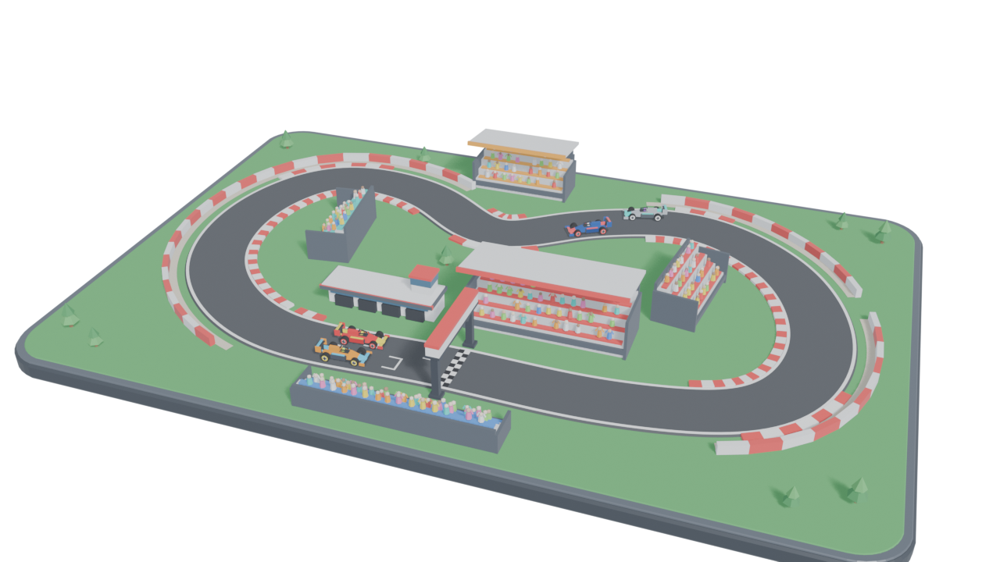

# F1 Tabletop AR

A lightweight proof-of-concept WebAR tabletop Formula 1 circuit built in Blender 5.2 LTS — designed to drop right onto a dining room table (~0.98m × 0.66m default scale, pinch-to-resize in AR).

## What's Inside
- **Closed GP Circuit** on a rounded tabletop diorama plinth with asphalt, white track lines, red/white apex curbs, gravel traps, Tecpro corner barriers, checkered start/finish grid, start gantry with glowing lights, and pit garage + control tower.
- **4 Animated F1 Cars** (Red, Papaya, Blue, Silver) with open wheels, Pirelli-style tire rings, halos, driver helmets, and spinning wheels racing around a seamless 8-second loop with side-by-side overtaking.
- **5 Grandstands & ~190 Simple Cheering Fans** doing a subtle stadium wave.
- **Cross-Platform AR**:
  - `assets/f1_tabletop_track.glb` — WebXR / Android Scene Viewer / desktop 3D preview (`<model-viewer>`)
  - `assets/f1_tabletop_track.usdz` — Native iOS AR Quick Look
  - `blender/f1_tabletop_track.blend` — Full Blender source scene

## Try It in AR
Open the GitHub Pages link on your phone and tap **Place on Table (AR)**, then point your camera at a dining room table.
